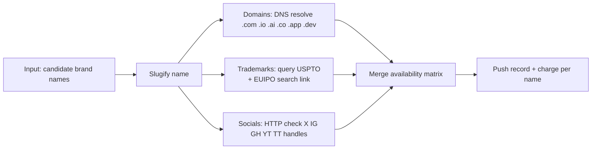

# Brand Name Availability Check: Trademark, Domains & Social Handles

[](https://apify.com/Turboextract/brand-availability-check)
[](LICENSE)
[](#pricing)

**Check a brand name across USPTO trademarks, .com/.io/.ai/.co/.app/.dev domains, and X/GitHub/YouTube handles — in one call, with one-click EUIPO, Instagram and TikTok verification links.** Built for founders, naming agencies, and brand consultants who screen dozens of candidates per project.

Paste a list of names. Get back a full availability matrix per name. Pay per name, not per lookup.

**Try it now →** [apify.com/Turboextract/brand-availability-check](https://apify.com/Turboextract/brand-availability-check)

> This repository holds documentation and ready-to-run API examples. The actor itself runs on the Apify platform - no installation needed.

---

## Why this exists

- **Naming projects screen dozens of candidates.** Checking each one across registrars, trademark offices and five social networks by hand takes hours.
- **One matrix per name.** Domains, USPTO trademarks and social handles come back in a single record you can sort and filter. Where a source blocks automated checks (EUIPO, Instagram, TikTok) you get `available: null` plus a direct verification link - never a guess.
- **Kill bad names early.** Spend legal review time only on the candidates that survive the first pass.

---

## Who this is for

- **Founders naming a new company or product** — screen 20 shortlist names in minutes
- **Naming agencies** — batch-check 100+ candidates per client brief
- **Brand consultants and IP paralegals** — pre-clear names before formal filing
- **Agencies managing brand portfolios** — periodic re-checks on client marks
- **Domain investors** — surface naming gaps across TLDs and handles

If you currently paste each name into Namecheap, TESS, EUIPO, X, and GitHub by hand, this replaces 7 tabs × N names.

---

## What you get per name

```json
{
  "brandName": "Lumenforge",
  "slug": "lumenforge",
  "domains": [
    { "host": "lumenforge.com", "available": false },
    { "host": "lumenforge.io", "available": true },
    { "host": "lumenforge.ai", "available": true },
    { "host": "lumenforge.co", "available": false },
    { "host": "lumenforge.app", "available": true },
    { "host": "lumenforge.dev", "available": true }
  ],
  "trademarks": [
    { "registry": "USPTO", "available": true, "exactMatches": 0, "similarMarks": 3, "liveMarks": [], "searchUrl": "https://tmsearch.uspto.gov/..." },
    { "registry": "EUIPO", "available": null, "note": "EUIPO has no public search API - open searchUrl to check manually", "searchUrl": "https://www.tmdn.org/tmview/..." }
  ],
  "socials": [
    { "platform": "twitter", "handle": "lumenforge", "url": "https://x.com/lumenforge", "httpStatus": 404, "available": true },
    { "platform": "instagram", "handle": "lumenforge", "url": "https://www.instagram.com/lumenforge/", "httpStatus": 429, "available": null, "note": "Instagram blocked the automated check - open the URL to verify" },
    { "platform": "github", "handle": "lumenforge", "url": "https://github.com/lumenforge", "httpStatus": 404, "available": true },
    { "platform": "youtube", "handle": "lumenforge", "url": "https://www.youtube.com/@lumenforge", "httpStatus": 404, "available": true },
    { "platform": "tiktok", "handle": "lumenforge", "url": "https://www.tiktok.com/@lumenforge", "available": null, "note": "TikTok blocks automated checks - open the URL to verify" }
  ],
  "checkedAt": "2026-11-08T12:00:00Z"
}
```

`available: true` = free. `available: false` = taken. `available: null` = not checked automatically or check could not be completed - open the link to verify.

> **Not legal clearance.** A USPTO `available: true` only means no *live* US mark with the *exact* same name. Similar or misspelled marks, marks in other countries, and unregistered (common-law) brands are not flagged - review `similarMarks` and talk to a trademark attorney before you file or launch.

Real output from a verified run: [examples/sample-output.json](examples/sample-output.json).

---

## How it works



All three channel groups run in parallel per name for speed.

---

## Quick start

### From the Apify Console (no code)

1. Click **Try for free**.
2. Paste your candidate brand names (one per line).
3. Click **Start**.
4. Download the availability matrix as JSON, CSV, or Excel.

### From the API ([curl](examples/curl.sh))

```bash
curl -X POST "https://api.apify.com/v2/acts/Turboextract~brand-availability-check/runs?token=YOUR_TOKEN" \
  -H "Content-Type: application/json" \
  -d '{
    "brandNames": ["Lumenforge", "Northwind", "Kestrel"],
    "checkDomains": true,
    "checkTrademarks": true,
    "checkSocials": true
  }'
```

### From Python ([full example](examples/python.py))

```python
from apify_client import ApifyClient

client = ApifyClient("YOUR_TOKEN")
run = client.actor("Turboextract/brand-availability-check").call(run_input={
    "brandNames": ["Lumenforge", "Northwind"],
})
for r in client.dataset(run["defaultDatasetId"]).iterate_items():
    print(r["brandName"], [d for d in r["domains"] if d["available"]])
```

### From Node.js ([full example](examples/node.mjs))

```javascript
import { ApifyClient } from 'apify-client';

const client = new ApifyClient({ token: 'YOUR_TOKEN' });
const run = await client.actor('Turboextract/brand-availability-check').call({
    brandNames: ['Lumenforge', 'Northwind', 'Kestrel'],
});
const { items } = await client.dataset(run.defaultDatasetId).listItems();
console.log(items);
```

---

## Input fields

| Field | Type | Default | Description |
|---|---|---|---|
| `brandNames` | array | required | Candidate names (strings) |
| `checkDomains` | boolean | true | DNS-resolve .com/.io/.ai/.co/.app/.dev |
| `checkTrademarks` | boolean | true | USPTO live-mark search + EUIPO search link |
| `checkSocials` | boolean | true | X, GitHub, YouTube handles (+ Instagram and TikTok verification links) |

---

## Pricing

**Pay per name checked. No subscriptions.**

| Volume | Price per name | Total |
|---|---|---|
| Per name | $0.010 | 100 names = $1 |
| 1,000 names | $0.010 | $10 |
| 10,000 names | $0.010 | $100 |

Each `name-checked` charge covers one name across all enabled channels (up to 13 lookups: 6 domains + 2 trademarks + 5 socials).

### How it compares

| Tool | Pricing model | 100 names fully checked |
|---|---|---|
| **Brand Availability Check** | $0.01 per name | **$1** |
| Namecheckr | Free but single-name | 100 manual pastes |
| Knowem | $84 for 1 name × 25 socials | $8,400 |
| Trademarkia pre-clearance | $29 per name | $2,900 |
| Hire a paralegal | $50-100 per name | $5,000-10,000 |

---

## Common use cases

- **Naming sprint shortlisting** — run 50 candidates, keep the 5 with best overall availability
- **Pre-filing trademark clearance** — spot live USPTO conflicts (and jump straight to the EUIPO search) before paying filing fees
- **Portfolio audits** — re-check existing client marks for new conflicts
- **Domain-opportunity sniping** — surface open .io / .ai variants for taken .com brands
- **Social handle grabs** — reserve handles across platforms before launch

---

## Tips for best results

- Candidate names should be 4+ characters — ultra-short names (3 chars) collide with dictionary words on socials
- Trademark `available: true` means no live exact-match US mark - a useful first filter, not legal advice. If `similarMarks` is above 0, open `searchUrl` and review them, then confirm with counsel before filing
- DNS "available" means no DNS record. Some registered-but-parked domains resolve; some truly unregistered return ENOTFOUND. For purchase, confirm via WHOIS.
- Social `available` relies on HTTP 404 — some platforms rate-limit and may return null; re-run skipped names

---

## Pairs well with

- **[B2B Lead Enrichment Pipeline](https://apify.com/Turboextract/b2b-lead-enrichment-pipeline)** — enrich an existing competitor domain to size up the taken-name owner
- **[Global Sanctions Screening](https://apify.com/Turboextract/global-sanctions-screening)** — different buyer, same account

---

## FAQ

**Is a `true` trademark result legal clearance?**
No. It is a first-pass screen against the USPTO register that only counts live marks with exactly the same name. It does not flag similar or misspelled marks, marks filed in other countries (EUIPO is a manual link), or unregistered common-law brands - any of which can block a filing or lead to a dispute. Full clearance requires attorney review and conflict analysis across classes and jurisdictions.

**Why DNS instead of WHOIS?**
WHOIS is rate-limited and inconsistent across registrars. DNS is instant and reliable as a first-pass signal. For final purchase, re-check via WHOIS or your registrar.

**Which socials are supported?**
X, GitHub and YouTube are checked automatically. Instagram (rate-limited) and TikTok (bot check) block most automated lookups, so they return `available: null` with a direct link to verify - never a guess. Reddit, Discord, Mastodon, Bluesky on the roadmap.

**Why does my check return `available: null` sometimes?**
EUIPO, Instagram and TikTok always return `null` with a link, because they block automated checks. Elsewhere, `null` means a rate limit or temporary error - re-run just that name and the field usually resolves.

**Can I check names with spaces or punctuation?**
Yes — the display name is preserved, but the slug (lowercased, alphanumeric-only) is what's used for domains and handles.

**Can I add international trademark registries (WIPO, UKIPO, CIPO)?**
On the roadmap. Open an issue with a priority registry to upvote.

**Can I run this on a schedule?**
Yes. Apify's scheduler supports any cron expression. Run weekly on your protected marks to catch new filings.

---

## SEO keywords

For visitors who arrived here from search: this tool is also referred to as a **brand name availability checker**, a **trademark search API**, a **bulk domain availability checker**, a **social media handle checker**, a **startup name checker**, an **username availability across platforms**, an **USPTO trademark lookup**, and a **business name validation tool**.

---

## Support

- Open an issue on this repo for bug reports - please include your run input
- Actor page on Apify: [apify.com/Turboextract/brand-availability-check](https://apify.com/Turboextract/brand-availability-check)
- Community Discord: [discord.gg/8SrXSCpvgj](https://discord.gg/8SrXSCpvgj) - updates, support and feature requests
- Maintained by [Turboextract](https://apify.com/Turboextract) on the Apify platform

## License

[MIT](LICENSE) - examples and documentation. The actor itself is hosted on Apify under their platform terms.
